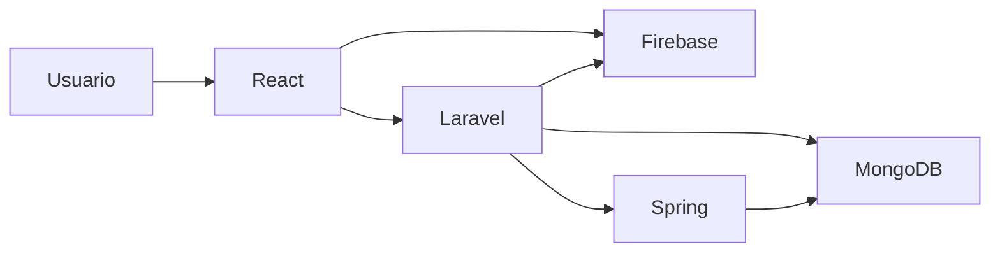

# Informe técnico — borrador estructurado según la rúbrica

Proyecto: Clínica Veterinaria El Tambo — prototipo académico, no oficial.

Este borrador distingue implementación en código de evidencia aún pendiente. No es un informe final listo para entregar.

## Portada e índices

Universidad, escuela, asignatura Programación Web, docente, NRC, fecha, integrantes y roles: PENDIENTE DE CONFIRMAR.
Generar índice general e índice de figuras y tablas en la versión de documento.

## 1. Introducción

### Descripción y problema
Prototipo de un portal para consultar servicios, catálogo informativo de productos, datos públicos de contacto y gestión de citas veterinarias. Demuestra una propuesta tecnológica para organizar disponibilidad, reservas e historial de cada usuario, sin representar una plataforma oficialmente operada por la clínica.

### Objetivos
Implementar una interfaz responsiva y una aplicación por capas con autenticación, servicios REST, CRUD, datos NoSQL, gestión de permisos, pruebas y despliegue funcional.

### Justificación y antecedentes
La interfaz y la gestión de reservas buscan facilitar la consulta y administración de información de atención veterinaria. Referencias académicas y antecedentes comprobables: PENDIENTE.

### Tecnologías
React 19, Vite 7, Bootstrap 5, Laravel 12, PHP 8.3, Spring Boot 3, Java 21, Firebase Authentication, MongoDB Atlas, GitHub Actions y Render.

## 2. Marco teórico

Desarrollar y citar según los materiales de clase: estructura HTML, estilos CSS, JavaScript, eventos, React, arquitectura por capas, servicios REST, programación asíncrona, MongoDB y modelos documentales, CRUD, índices y explain, seguridad, autenticación/autorización, validación, manejo de errores, pruebas y diseño responsivo. Bibliografía y número de diapositiva/página: PENDIENTE.

## 3. Desarrollo de la solución

### Actores y requerimientos
Visitante: consultar información y catálogo. Cliente registrado: iniciar sesión, reservar, editar y cancelar sus propias citas, consultar estadísticas. Administrador: gestionar productos, veterinarios y horarios.

### Arquitectura
El navegador ejecuta React y obtiene tokens de Firebase Authentication. React llama a la API Laravel; Laravel verifica el token, valida reglas de negocio y consulta MongoDB. Laravel usa Spring Boot para estadísticas; Spring consulta MongoDB.

### Flujo de reserva
Formulario React → validación cliente → solicitud HTTP con Bearer token → middleware Firebase → controlador Laravel → servicio de disponibilidad → modelo MongoDB → respuesta JSON → actualización visual.

### Diagrama

## 4. Estructura y diseño del sitio

Páginas: Inicio, Servicios, Productos, Citas, Contacto, Estadísticas y Administración. El panel de administración depende del rol verificado por el servidor. Describir componentes y navegación y extraer paleta y tipografías reales de frontend/src/styles.css. Capturas: PENDIENTE.

## 5. Base de datos

Base de datos Atlas configurada: ClinicaVeterinariaElTambo. Colecciones de la implementación: citas, veterinarios, horario_veterinarios y productos. La colección de productos puede crearse al insertar el primer documento. Campos de citas: ownerUid, mascota, propietario, especie, motivo, fechaHoraUtc, veterinarioId y estado.

Crear diagrama de documentos y relaciones tras validar los registros de prueba. No incluir cadena de conexión con contraseña.

CRUD: POST y GET de citas/productos, PUT de actualizaciones, DELETE lógico para cancelar citas y retirar productos. Adjuntar respuesta API y datos antes/después: PENDIENTE.

## 6. Funcionalidades y evidencias

Probar inicio y cierre de sesión, búsqueda de servicios y productos, reserva/edición/cancelación, filtro de citas, estadísticas, administración de veterinarios y productos. Evidencias verificadas: PENDIENTE. No incluir precios oficiales ni fotografías de productos sin validación de la clínica.

## 7. Código fuente

Frontend: frontend/src/App.jsx, Catalogo.jsx, Administracion.jsx, api.js. Servicios: api/app/Services/CitaService.php y DisponibilidadService.php. Seguridad: VerificarFirebase.php, SoloAdministrador.php, CabecerasSeguras.php. Datos: api/app/Models. Estadísticas: spring-estadisticas/src/main/java.

Incluir fragmentos breves del código real que muestren validación, filtrado por usuario, roles, manejo de errores, llamadas REST y persistencia.

## 8. Responsividad y compatibilidad

Capturas pendientes de escritorio, tableta y teléfono. Anotar medidas de pantalla, navegadores, navegación por teclado, contraste y fallos corregidos.

## 9. Trabajo colaborativo

Integrantes, roles reales, fechas, tareas y enlaces de commits/PR: PENDIENTE. No atribuir tareas no realizadas.

## 10. Conclusiones

Redactar al terminar pruebas. Documentar dificultades reales como rutas Apache en Render y configuración de Firebase, distinguiendo lo resuelto de lo pendiente. Proponer mejoras futuras como mayor automatización de pruebas y documentación del catálogo.

## Referencias de evidencia

- EVIDENCIAS_Y_PRUEBAS.md
- PLAN_SEGURIDAD_Y_PRUEBAS.md
- COMPARACION_CONSULTAS.md
- MATRIZ_RUBRICA_ENTREGA.md

## Adiciones recientes al sistema

Se añadieron en GitHub autenticación Google con Firebase, recuperación/verificación de correo, filtro de catálogo desde Laravel, agrupación de estadísticas en Spring Boot y mejoras de accesibilidad, rendimiento y SEO. Su funcionamiento en producción requiere evidencias reales según `GUIA_MEJORAS_INTEGRACION.md`. La verificación Search Console es opcional y el sitio sigue identificado como no oficial; no afirmar que sea el sitio oficial de la clínica.
